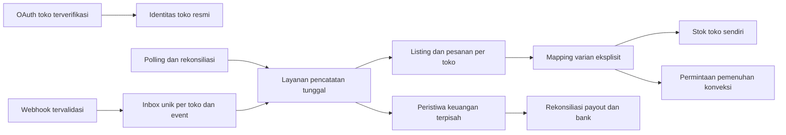

# Integrasi toko terotorisasi: hasil audit dan tahapan

Status 24 Oktober 2026: alur seller OAuth resmi Shopee dan TikTok Shop, state satu kali, pertukaran token, verifikasi identitas toko, penyimpanan token terenkripsi, reconnect/disconnect, dan antrean sinkronisasi awal sudah diimplementasikan. **Kredensial/approval platform dan worker resource live masih diperlukan sebelum operasi produksi.** Jangan mendaftarkan URL webhook lokal atau menganggap status `Terhubung` lama sebagai bukti otorisasi.

Pembaruan UI: `marketplace.php` kini membuka ringkasan lintas toko sebagai pintu masuk, lalu menyediakan dashboard per toko dan halaman integrasi dengan gaya biru–oranye. Ringkasan hanya mengagregasi toko dalam perusahaan aktif. Label koneksi OAuth, antrean job, dan waktu keberhasilan sinkronisasi dibedakan. Tanggal sukses dari tabel toko lama tidak ditampilkan sebagai bukti API resmi. Tombol sinkronisasi hanya menambahkan job ke antrean; worker live belum tersedia. UI alokasi stok lintas gudang disembunyikan. Impor settlement CSV lama dinonaktifkan di layanan karena pernah menebak HPP/biaya dan memakai rekening Konveksi bersama; tidak ada migrasi data operasional atau perubahan saldo/stok oleh pembaruan UI ini.

## Temuan

- `marketplace_api_credentials` menyimpan rahasia tanpa enkripsi. `testConnection` lama hanya menghitung signature lokal, `refreshOAuthToken` membuat token acak, `syncStoreData` mengubah waktu sukses tanpa panggilan API, dan cron menandai pesanan selesai lewat simulasi. Jalur ini ditutup.
- Webhook lama memilih salah satu dari dua ID toko yang ditanam di kode, lalu mengakui event tanpa inbox tahan lama. Sekarang mengembalikan HTTP 503 sampai kontrak signature, identitas toko, serta inbox resmi terpasang.
- `marketplace_stores` lama memiliki status yang dapat diubah pengguna, identitas toko berbasis nama, dan tidak memiliki `company_id`. Beberapa toko contoh/seed belum terbukti terotorisasi. `Tokopedia` dan `Lazada` adalah platform berbeda dalam enum lama; cakupan konektor baru hanya Shopee dan TikTok Shop.
- Pesanan, item, HPP, stok, rekening, pencairan, dan jurnal lama memiliki relasi silang ke tabel konveksi. Klasifikasi tiap baris diperlukan sebelum cutover. Lihat [rencana ruang kerja](./RENCANA_MIGRASI_RUANG_KERJA.md).
- Laporan lama memuat aturan khusus nomor pesanan dan pernah menampilkan total laba konstan. Konstanta total laba dan ROAS default sudah dihapus, tetapi rumus dan provenance seluruh laporan lama masih perlu audit.

## Jalur pencatatan target

`MarketplaceIngestionService` adalah fondasi untuk identitas toko, OAuth state satu kali, inbox event deduplikasi, dan upsert pesanan/item transaksional. `MarketplaceInboxService` mengklaim pekerjaan per toko dengan lease, retry dan backoff; lease lama tidak dapat menandai pekerjaan baru selesai. Penulisan ini **belum** menghasilkan mutasi stok, saldo, atau jurnal. Status sumber yang lebih lama tidak menimpa snapshot lebih baru; HPP item yang pertama tercatat dipertahankan. Event refund tetap membutuhkan model tersendiri, sehingga tidak diwakili oleh transisi status pesanan saja.

## Skema dan klasifikasi lama

`database/migration_marketplace_integration_review.sql` menambah tabel kosong untuk toko, OAuth state, inbox, checkpoint, listing, pesanan/item, mapping, penanda dampak bisnis, peristiwa keuangan, dan relasi payout ke banyak pesanan. Tidak ada migrasi operasional yang dijalankan. Unik `(platform, external_store_id)` menghalangi klaim lintas perusahaan sampai aturan delegasi dibuat. Unik `(store_id, external_order_id)`, `(order_id, external_item_id)`, `(store_id, external_event_id)`, dan kunci efek bisnis menghalangi duplikasi.

Sebelum migrasi, buat daftar review dengan `source_table`, `source_id`, `store_id` lama, identitas toko eksternal resmi, bukti sumber, keputusan, dan peninjau. Baris dengan identitas toko, order, payout, atau sumber stok tidak jelas tetap `review_required`. Jangan cocokkan hanya nama toko, SKU, atau nominal. Saldo awal, stok awal, dan jurnal koreksi memerlukan rekonsiliasi tersendiri. Jangan mengubah atau menghapus data lama otomatis.

## Langkah aktivasi yang masih diperlukan

1. Dapatkan akses app partner, lingkungan uji, scopes, callback HTTPS publik, dan identitas perusahaan pengguna. Verifikasi versi dokumentasi dan kebutuhan izin untuk setiap endpoint Shopee Seller dan TikTok Shop Seller. Dokumentasi Shopee terbaru yang dapat diakses publik belum cukup untuk memvalidasi semua kontrak webhook; tidak ada endpoint yang ditebak.
2. Alur OAuth per platform sudah tersedia pada `public/api/marketplace-oauth.php`. State terikat user/perusahaan/platform/return path, validasi identitas dilakukan setelah token exchange, scopes/expiry disimpan, token dienkripsi dengan key di luar kode, refresh memakai API nyata, dan disconnect mempertahankan histori. Lihat [setup OAuth](./MARKETPLACE_OAUTH_SETUP.md).
3. Implementasikan verifikasi signature sesuai kontrak platform dan toko, simpan inbox sebelum acknowledgment, lalu worker dengan penguncian, retry/backoff, dead letter dan observabilitas. Polling memakai checkpoint, pagination dan overlap; semua masuk penulis yang sama.
4. Job `products`, `variants`, dan `orders` sudah dibuat setelah koneksi terverifikasi dan ditampilkan sebagai antrean; worker resource resmi, pagination/checkpoint/rate-limit, mapping varian, sumber stok, reservasi/permintaan pemenuhan eksplisit, jurnal berimbang, payout parsial dan batch, refund/penyesuaian masih harus dilengkapi sebelum data dianggap tersinkron.
5. Uji di database pengujian dengan payload resmi dari sandbox, event duplikat, terlambat, out-of-order, token kedaluwarsa, pencabutan izin, banyak toko/perusahaan, retry dan concurrency. Setelah klasifikasi serta backup disetujui, rehearsal migrasi dan cutover bertahap. Pemulihan mengikuti [rencana ruang kerja](./RENCANA_MIGRASI_RUANG_KERJA.md).

## Uji yang dijalankan

`php tests/marketplace_ingestion_smoke.php` membuat database terpisah dan memeriksa kunci toko, larangan klaim lintas perusahaan, OAuth state sekali pakai, deduplikasi inbox/order/item, retry dan lease, order lintas toko, refund terlambat, rollback input invalid, HPP historis, dan tidak adanya efek stok/keuangan. Database uji terakhir: `jl_marketplace_test_20261023_191135_083402`. Uji ini tidak memvalidasi koneksi atau payload platform live.
