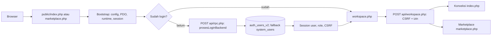
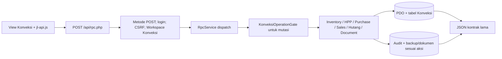
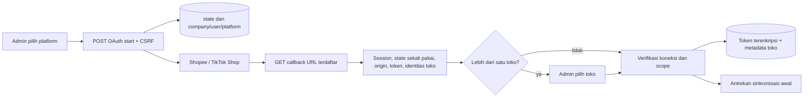
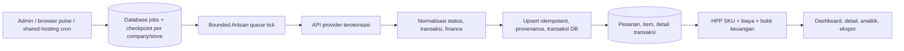
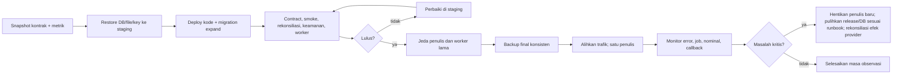
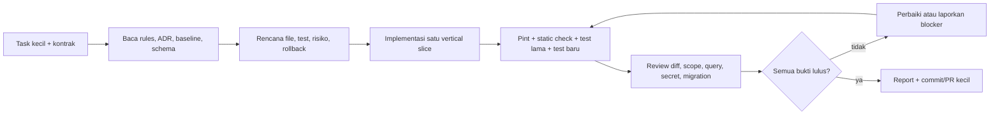

# Rencana modernisasi dan migrasi Jago Laba

Status: rancangan kerja, 29 Oktober 2026. Belum ada perubahan aplikasi, database, konfigurasi server, atau integrasi Live dari dokumen ini.

## 1. Keputusan yang harus ditetapkan

Permintaan ini sekarang diarahkan ke **Laravel 13** dengan migrasi bertahap. Target ini dipilih karena konvensi Laravel membuat lokasi route, controller, request, policy, migration, job, command, view, dan test mudah dibaca oleh AI agent. Laravel 13 mendukung PHP 8.3–8.5 menurut catatan rilis resmi; proyek ini menetapkan **PHP 8.4** sebagai satu-satunya target runtime agar konsisten dengan shared hosting.

Keputusan awal tersebut dicatat dalam [ADR-001: baseline stack dan batas migrasi](adr/ADR-001-laravel-modernization-stack.md). ADR menetapkan target Laravel 13, **PHP 8.4**, shared hosting dan kemampuan cron/CLI yang tersedia, document root dan URL kanonis, strategi session, database queue/cache, toleransi downtime, target RPO/RTO, urutan modul, dan penanggung jawab keputusan produk serta data. Default perencanaan: satu repositori dan satu database MySQL/MariaDB sesuai host, URL publik lama tetap tersedia, satu penulis aktif untuk setiap proses bisnis, tanpa Redis, tanpa proses worker yang hidup terus, dan perpindahan per fitur tanpa mengganti ID/nominal.

### Hasil yang dituju

1. Endpoint lama tetap berfungsi selama masa transisi, termasuk `/index.php`, `/marketplace.php`, `/workspace.php`, `/api/rpc.php`, dan callback OAuth.
2. Aturan bisnis berada di service/use case yang dapat dipanggil oleh controller lama maupun baru.
3. Autentikasi, CSRF, role, company/store scope, dan audit berlaku pada setiap jalur tulis.
4. Migrasi schema tercatat, dapat diulang secara aman, dan dipisahkan dari seed/repair.
5. Pekerjaan sinkronisasi hanya memiliki satu pemilik eksekusi per toko/job; retry tidak membuat efek ganda.
6. Hasil keuangan dan HPP sebelum/sesudah migrasi dapat direkonsiliasi pada data staging yang sama.
7. Release dan rollback telah diuji dengan restore database, file privat, dan key yang cocok.

### Bukan bagian otomatis dari migrasi

Mengganti database, mengubah identitas toko/pesanan/SKU, menyatukan HPP produksi dengan HPP SKU marketplace, mengaktifkan webhook, mengganti provider API, membangun ulang UI, atau memindahkan hosting. Masing-masing memerlukan keputusan dan uji tersendiri.

## 1A. Stack target Laravel yang umum dan gratis

Stack berikut adalah baseline implementasi. Paket tambahan dipasang sedikit demi sedikit dan dikunci di `composer.lock`/`package-lock.json`; jangan memasang seluruh ekosistem sekaligus.

| Lapisan | Pilihan target | Cara dipakai pada migrasi |
|---|---|---|
| Runtime | PHP 8.4; Laravel 13 | Pastikan shared hosting menyediakan PDO MySQL/MariaDB, cURL, OpenSSL/sodium, mbstring, JSON, ZIP/XML, fileinfo, dan CLI PHP bila cron akan menjalankan Artisan. |
| Framework | Laravel 13 | Menjadi bootstrap, router, container, config, middleware, validation, response, console, migration, queue, dan test harness. |
| UI | Vue 3 + TypeScript + Inertia 3 + Vite | Target UI tunggal. Tidak memakai Livewire, React, Svelte, atau SSR Node di production. Halaman dibangun sebagai Inertia page dan tetap dilayani oleh PHP. |
| CSS/komponen | Tailwind CSS 4 + komponen gratis yang kompatibel dengan Vue/Inertia | Build asset dilakukan lokal/CI; shared hosting hanya menerima hasil `public/build`. Pertahankan URL dan alur lama selama adapter masih dipakai. |
| Auth browser | Laravel session auth dari starter kit resmi; password hash lama dibaca melalui adapter | Login browser tetap cookie/session. Migrasikan user bertahap setelah verifikasi hash, role, dan sesi. |
| API | Laravel Sanctum untuk API token atau SPA cookie; middleware `auth:sanctum` hanya pada endpoint yang sesuai | Jangan mengganti session first-party menjadi bearer token tanpa alasan. Pertahankan kontrak API lama melalui route adapter. |
| Otorisasi | Middleware, Gates, Policies, dan service `CompanyContext`/`StoreContext` | Memetakan `Workspace`, `RolePolicy`, dan `MarketplaceScopeService`; semua query tulis wajib membawa scope server. |
| Data | MySQL yang sudah dipakai; Eloquent untuk kode baru, Query Builder/raw SQL untuk query legacy dan nominal sensitif | Jangan melakukan konversi ORM massal sebelum hasil query dan rekonsiliasi nominal sama. |
| Migrasi schema | Laravel migrations + registry lama yang dibungkus command terkontrol | Gunakan expand/contract; setiap migration memiliki owner, precondition, post-check, dan rollback yang realistis. |
| Queue | Laravel Queue dengan **database driver** dan tabel `jobs`/`failed_jobs` | Tidak membutuhkan Redis atau Horizon. Job harus pendek, idempotent, dapat dilanjutkan, dan diproses memakai cron `queue:work --stop-when-empty` atau command tick berbatas waktu. |
| Scheduler | Laravel Scheduler + satu cron shared hosting, bila tersedia | Satu entry cron menjalankan `php artisan schedule:run` setiap menit. Bila cron/CLI tidak tersedia, gunakan browser pulse/manual sync sebagai mode degradasi dengan status yang jelas. |
| HTTP provider | Laravel HTTP Client/Guzzle dengan adapter Shopee/TikTok yang terisolasi | Timeout, retry, rate limit, request ID, dan redaction secret berada di boundary integrasi. |
| Storage | Laravel Filesystem `local` private untuk dokumen; disk S3-compatible hanya opsi tahap lanjut | Pertahankan file ID/metadata/URL berizin; jangan mengekspos disk private melalui symlink publik. |
| Testing | Pest 4 untuk test baru, PHPUnit yang kompatibel untuk test legacy; `php artisan test` sebagai pintu utama | HTTP contract, authorization, integration, sync, finance, file, dan migration test menjadi bukti per fase. |
| Quality | Laravel Pint; PHPStan + Larastan setelah baseline stabil | Pint wajib pada file yang disentuh; static analysis dinaikkan bertahap agar tidak menghalangi migrasi awal. |
| Local/build runtime | Composer, PHP 8.4, Node.js LTS + npm, MySQL/MariaDB; Docker/Sail opsional lokal | Node dan Composer boleh hanya dipakai lokal/CI. Production shared hosting menerima `vendor` teroptimasi dan hasil `public/build`; jangan mengandalkan Docker/Node di host. |
| AI context | Laravel Boost sebagai dev dependency; `.ai/guidelines/`, `.ai/rules/`, dan MCP Boost | Agent mendapat konteks versi package, schema, query, docs, Tinker, browser logs, dan aturan proyek. |
| CI | GitHub Actions atau runner CI kompatibel; job Composer, Pint, static analysis, test, build asset | Gratis dalam kuota layanan yang dipilih; tidak bergantung pada CI untuk backup atau migrasi production. |

### Batas penggunaan paket

- Tidak menggunakan Laravel Nova, layanan hosting berbayar, database cloud, atau layanan auth berbayar sebagai prasyarat.
- Tidak menambah Livewire, React, atau Svelte. Baseline UI adalah Vue 3 + TypeScript + Inertia 3; tidak ada Livewire atau SSR Node.
- Tidak memakai Redis, Horizon, Supervisor, Docker, atau proses daemon sebagai prasyarat production. Database queue dan cron adalah baseline.
- Job sync harus memiliki batas waktu, checkpoint, lock database/cache yang tersedia, dan dapat dijalankan ulang tanpa efek ganda. Jangan membuat satu request web menunggu seluruh sinkronisasi.
- Jika host tidak menyediakan cron/CLI, fitur sinkronisasi otomatis diturunkan menjadi manual atau browser pulse; status terakhir, error, dan tombol retry harus terlihat di UI.
- `npm run build` dijalankan sebelum upload. Node.js tidak diperlukan di server production.
- Document root idealnya menunjuk folder `public`. Bila panel hosting tidak mendukungnya, gunakan domain/subdomain dengan document root terpisah atau konfigurasi rewrite yang diuji; jangan menaruh `.env`, `vendor`, `storage`, atau source aplikasi di public.
- Laravel Boost dipasang sebagai alat pengembangan AI, bukan dependency runtime pengguna. Perintah `boost:install` dijalankan setelah project Laravel dan aturan scope tersedia.

## 1C. Profil deployment shared hosting

### Artefak yang di-upload

```text
domain-document-root/              # idealnya menunjuk ke release/public
  index.php
  build/                            # hasil npm run build
project-private/
  app/ bootstrap/ config/ database/ routes/ resources/ vendor/
  storage/app/private/              # dokumen privat, di luar public bila memungkinkan
  .env                              # dibuat melalui panel/CLI, tidak di-commit
```

Jalankan `composer install --no-dev --optimize-autoloader` dan `npm run build` pada mesin build/CI. Upload `vendor` dan `public/build` yang sudah jadi bila Composer atau Node tidak tersedia pada hosting. Jangan upload `.env`, source map yang membuka secret, backup DB, dump, key mentah, `.git`, atau folder temporary. Setelah upload, jalankan `php artisan optimize` hanya jika CLI hosting tersedia dan environment production sudah benar; cache config yang dibuat pada mesin lain tidak boleh membawa nilai environment yang salah.

Baseline environment shared hosting:

```text
APP_ENV=production
APP_DEBUG=false
APP_URL=https://domain-anda.example
SESSION_DRIVER=database
CACHE_STORE=database
QUEUE_CONNECTION=database
FILESYSTEM_DISK=local
```

Nilai database, `APP_KEY`, provider credential, dan token vault diisi melalui panel/CLI host. `SESSION_DRIVER`/`CACHE_STORE` database membutuhkan tabel Laravel yang sesuai; agent harus membuat dan memeriksa migration-nya di staging sebelum upload. Bila database cache tidak tersedia, file cache privat dapat menjadi fallback untuk lock lokal satu server, tetapi bukan alasan untuk menjalankan dua worker bersamaan.

### Cron dan queue tanpa Redis

Baseline production memakai database queue. Satu cron menjalankan scheduler dan satu cron menjalankan worker singkat, contohnya:

```text
* * * * * cd /home/ACCOUNT/project && /usr/local/bin/php artisan schedule:run >> storage/logs/scheduler.log 2>&1
* * * * * cd /home/ACCOUNT/project && /usr/local/bin/php artisan queue:work database --stop-when-empty --max-time=45 --timeout=35 --tries=2 >> storage/logs/queue.log 2>&1
```

Path PHP, folder project, izin cron, `max_execution_time`, dan batas CPU/memori berbeda per host; agent harus mencatat nilai aktual di deployment ADR. `--stop-when-empty` membuat proses selesai setelah antrean kosong sehingga tidak memerlukan daemon atau Supervisor. Job sinkronisasi wajib membatasi jumlah toko/halaman per eksekusi, menyimpan checkpoint, dan menjadwalkan kelanjutan. Gunakan lock database/cache yang tersedia dan `withoutOverlapping` untuk mencegah dua cron mengerjakan scope sama.

Jika shared hosting tidak menyediakan cron atau PHP CLI, jangan mensimulasikan worker panjang melalui request web. Sediakan tombol manual “jalankan satu langkah”, browser pulse dengan batas waktu, status `last_run/last_success/last_error`, dan instruksi bahwa otomatisasi belum aktif. Fitur yang memerlukan worker terus-menerus harus ditunda atau dipindahkan ke host worker terpisah; itu keputusan arsitektur baru.

### Batas teknis yang harus diukur di staging

- `upload_max_filesize`, `post_max_size`, `memory_limit`, `max_execution_time`, dan `max_input_time`.
- Batas waktu cron, jumlah cron yang diizinkan, dan apakah cron overlap dapat dicegah.
- PHP 8.4 CLI versus PHP-FPM/web extension; keduanya harus memakai `.env` dan database yang sama.
- Document root ke `public`, rewrite Apache/Nginx panel, HTTPS, session cookie, dan trusted proxy.
- Izin tulis `storage`, `bootstrap/cache`, private upload, log rotation, dan kapasitas database.
- Apakah symlink diizinkan; bila tidak, jangan mengandalkan `storage:link` untuk dokumen privat.

### Vue/Inertia di shared hosting

Production tidak menjalankan Node atau Inertia SSR. Vue/TypeScript dibuild lokal/CI dengan Vite menjadi `public/build`; Laravel mengirim halaman Inertia dan asset statis melalui PHP. Semua props harus tervalidasi di server dan setiap halaman penting memiliki fallback error/loading yang tidak bergantung pada dev server Vite. Agent tidak boleh mengubah URL/query/filter yang digunakan halaman lama tanpa contract test.

### Sumber resmi yang menjadi acuan versi

- Laravel 13 release/support: <https://laravel.com/docs/13.x/releases>
- Instalasi dan Laravel Boost: <https://laravel.com/docs/13.x> dan <https://laravel.com/docs/13.x/boost>
- Starter kits: <https://laravel.com/starter-kits>
- Sanctum: <https://laravel.com/docs/13.x/sanctum>
- Inertia Vue: <https://inertiajs.com/client-side-setup> dan <https://inertiajs.com/server-side-setup>
- Queue/database driver/Scheduler: <https://laravel.com/docs/13.x/queues>, <https://laravel.com/docs/13.x/scheduling>
- Testing/filesystem: <https://laravel.com/docs/13.x/testing> dan <https://laravel.com/docs/13.x/filesystem>
- Deployment/document root: <https://laravel.com/docs/13.x/deployment>

## 1B. Model kerja AI agent

AI agent dipakai sebagai pelaksana perubahan kecil yang dapat diperiksa, bukan sebagai pengganti keputusan bisnis atau persetujuan cutover. Setiap agent harus bekerja pada satu vertical slice dan mengembalikan bukti yang dapat diulang.

### Aturan wajib agent

1. Membaca `AGENTS.md`, `.ai/rules/*`, ADR, kontrak endpoint, dan test terkait sebelum mengubah file.
2. Menggunakan Laravel Boost untuk melihat versi package, schema, dokumentasi versi terpasang, query, Tinker, dan log bila tersedia.
3. Tidak menjalankan installer, migration production, seed production, repair, penghapusan data, pengiriman API Live, atau rotasi key tanpa task eksplisit dan checkpoint manusia.
4. Membuat branch/commit kecil dengan satu tujuan; tidak mencampur pemformatan global, rename massal, dan perubahan perilaku.
5. Menulis atau memperbarui contract/feature test sebelum memindahkan handler; test lama tetap dijalankan sampai adapter dihapus.
6. Melaporkan file yang diubah, perintah yang dijalankan, hasil test, query/migration yang berdampak, risiko, dan langkah rollback.
7. Menyimpan secret di environment/secret manager; agent hanya boleh memeriksa keberadaan dan formatnya, bukan menyalin nilainya ke laporan.
8. Memastikan setiap mutasi memiliki auth, CSRF bila browser, role/policy, company/store scope, transaksi, idempotency key atau unique constraint, dan audit yang setara.

### Pembagian agent yang disarankan

| Agent | Scope | Tidak boleh mengubah |
|---|---|---|
| `inventory-agent` | Inventaris route/RPC/JS/form, matriks kontrak, dependency graph | Runtime aplikasi dan DB production |
| `laravel-foundation-agent` | Skeleton Laravel, config adapter, autoload, session bridge, route facade, CI dasar | Aturan bisnis Marketplace/Keuangan |
| `auth-scope-agent` | User/session, workspace, role, company/store context, CSRF, policies | Query sinkronisasi provider |
| `konveksi-slice-agent` | Satu irisan Konveksi per task: master, pembelian, HPP, stok, penjualan, hutang, dokumen | Marketplace tables/provider |
| `marketplace-read-agent` | Dashboard, orders, catalog, analytics, views/read APIs | Endpoint tulis/provider write |
| `frontend-vue-agent` | Vue 3/TypeScript/Inertia pages, shared layouts, props, forms, Vite build, accessibility | Schema, provider, business rules tanpa contract task |
| `marketplace-write-agent` | HPP, price, stock, expense, finance refresh, fulfillment | Schema auth dan worker global |
| `oauth-integration-agent` | Adapter OAuth, callback, token vault, provider client | Pengiriman provider Live tanpa sandbox/stub |
| `queue-worker-agent` | Database Job, queue tick, lock, Scheduler, checkpoint, CLI/cron | Redis/Horizon, dua scheduler aktif, atau perubahan data tanpa rehearsal |
| `test-verification-agent` | Contract, feature, integration, browser, data reconciliation, performance | Perubahan perilaku tanpa acceptance evidence |

Satu agent reviewer memeriksa diff dan bukti; agent pelaksana tidak boleh menyetujui hasilnya sendiri untuk fitur berisiko tinggi. Bila hanya tersedia satu agent, peran tersebut tetap dijalankan sebagai tahapan terpisah dengan konteks baru dan checklist yang berbeda.

### Template task untuk agent

```text
Tujuan: migrasikan [fitur/endpoint] ke Laravel tanpa mengubah kontrak eksternal.
Baseline: [file lama, route, action, tabel, test].
Batas: [file/folder yang boleh disentuh]; jangan ubah [provider/schema/URL].
Kontrak: metode, input, output, status, redirect, header, role, workspace, company/store scope.
Implementasi: gunakan Laravel [controller/request/policy/model/job] dan Vue/Inertia page/form; adapter legacy tetap tipis.
Verifikasi: jalankan [test lama], [test baru], Pint pada file tersentuh, static check bila tersedia.
Bukti akhir: diff ringkas, daftar perintah + hasil, data/nominal yang dibandingkan, risiko, rollback.
Stop bila: scope tidak jelas, migration destructive, secret dibutuhkan, provider Live harus dipanggil,
atau kontrak baseline bertentangan. Laporkan blocker dan jangan menebak.
```

### Definition of Done per task

- Scope file dan tabel sesuai task.
- Test kontrak lama dan test target lulus pada fixture yang sama.
- Tidak ada perubahan ID, nominal, status, key, callback, atau efek provider yang tidak tercatat.
- Pint lulus pada file tersentuh; static analysis tidak menambah error baseline.
- Log tidak memuat token/PII; migration memiliki precondition/post-check.
- Diff dapat di-rollback dan agent menuliskan perintah rollback atau alasan rollback tidak otomatis.

## 2. Baseline yang ditemukan

| Area | Kondisi kode saat ini | Implikasi |
|---|---|---|
| Struktur | Sekitar 458 file PHP pada `app`, `public`, `routes`, `tests`, `scripts`, `database`, dan `bin`; 226 di `app`, 31 di `public` | Migrasi seluruh aplikasi sekaligus berisiko besar. Angka adalah hitungan file, bukan ukuran usaha yang presisi. |
| Dependency | [composer.json](../../composer.json) mensyaratkan PHP >=8.2 dan memakai classmap; belum ada dependency framework runtime | Target Laravel 13 dengan PHP 8.4; pasang dependency inti bertahap dan kunci lock file. |
| Bootstrap | [bootstrap.php](../../app/Bootstrap/bootstrap.php) memuat konfigurasi, PDO, SharedRuntime, Konveksi, dan session; modul juga memuat file manual | Perlu memisahkan boot umum dari boot per modul, lalu memilih satu mekanisme session per request. |
| Route | [web.php](../../routes/web.php) dan [api.php](../../routes/api.php) adalah katalog URL kompatibilitas, belum router aplikasi penuh | Route baru harus menjaga URL, metode, status, body, header, dan redirect yang dipakai JS/klien. |
| Konveksi | [rpc.php](../../app/Modules/Konveksi/Controllers/Api/rpc.php) menerima POST; [RpcService.php](../../app/Modules/Konveksi/Controllers/RpcService.php) melakukan dispatch nama metode dan login | Inventaris seluruh nama metode/argumen/respons RPC sebelum pemecahan per use case. |
| Marketplace UI | [marketplace.php](../../app/Modules/Marketplace/Controllers/marketplace.php) memilih toko/tab dan merender banyak view; file ini sekitar 243 KB | Pemecahan per halaman adalah pekerjaan utama, dengan redirect/query string lama tetap diuji. |
| Marketplace data | [MarketplaceService.php](../../app/Modules/Marketplace/Services/MarketplaceService.php) sekitar 128 KB; terdapat service khusus orders, catalog, finance, sync, OAuth | Pindahkan use case satu per satu; jangan mengganti semua query ke ORM secara serentak. |
| Database | [Database.php](../../app/Core/Database/Database.php) memakai PDO MySQL; migration berupa campuran PHP/SQL di [database/migrations/](../../database/migrations/) | Pertahankan PDO/raw SQL pada tahap awal dan buat registry migrasi yang diperiksa. |
| Integrasi | Callback [marketplace-oauth.php](../../app/Modules/Marketplace/Controllers/Api/marketplace-oauth.php) memakai session, state, redirect, dan URL yang memuat `/public/` | Domain, path, cookie, state, dan registrasi provider harus diuji bersama sebelum cutover. |
| Worker | [marketplace-cron.php](../../bin/workers/marketplace-cron.php) menjalankan sync CLI; [MarketplaceBackgroundSync.php](../../app/Modules/Marketplace/Jobs/MarketplaceBackgroundSync.php) bergantung pada Windows/PowerShell | Ganti dengan database queue + command tick berbatas waktu; shared hosting tidak boleh membutuhkan PowerShell, Redis, Supervisor, atau worker daemon. |
| Dokumen | [DocumentService.php](../../app/Shared/Support/DocumentService.php) saat ini menulis file ke storage privat dan memberi URL unduh berizin | Pertahankan kontrak file ID, metadata, key dan URL; periksa file legacy saat restore. Audit 27 Oktober tentang lokasi publik merupakan temuan historis yang perlu direkonsiliasi. |
| Webhook | [marketplace-webhook.php](../../app/Modules/Marketplace/Controllers/Api/marketplace-webhook.php) mengembalikan 503 | Tetap nonaktif selama migrasi, kecuali proyek webhook terpisah menyelesaikan verifikasi dan durable inbox. |
| Pengujian | Ada test Unit, Integration, Feature berbasis skrip PHP; tidak tampak PHPUnit di Composer | Pertahankan skrip sebagai regression baseline, lalu tambah Pest/PHPUnit Laravel feature tests dan `php artisan test`. |

Baseline ini berasal dari pembacaan statis. DB, ukuran tabel, jadwal proses aktif, performa, izin API Live, dan konfigurasi hosting belum diukur. Dokumen [restructure-result.md](restructure-result.md) menjelaskan pemindahan struktur terdahulu, bukan bukti bahwa migrasi framework telah dilakukan.

## 3. Peta alur proses saat ini dan titik migrasinya

### 3.1 Pintu masuk, login, dan pemilihan workspace



Sumber: [RpcService.php](../../app/Modules/Konveksi/Controllers/RpcService.php), [Workspace.php](../../app/Shared/Authorization/Workspace.php), [workspace.php](../../app/Shared/Auth/Api/workspace.php). Pada target, route/controller/middleware baru dapat membungkus service lama. Buat jembatan session yang membaca identitas dan role lama; jangan menjalankan dua mekanisme session untuk URL yang sama. Uji login baru, login lama, logout, session kedaluwarsa, CSRF salah, pergantian workspace, dan hak akses role.

### 3.2 Konveksi: baca dan ubah data



Pecah dispatch secara vertikal: mulai dari satu metode baca, lalu satu mutasi berisiko rendah. Pertahankan nama metode, urutan argumen, bentuk respons, error, dan syarat admin pada [RpcService.php](../../app/Modules/Konveksi/Controllers/RpcService.php). Mutasi penjualan, stok, HPP, hutang, dan dokumen dipindahkan hanya setelah fixture data dan invariant masing-masing tersedia. Konveksi tetap menggunakan company context yang sama; tidak boleh membaca atau menulis data perusahaan lain.

### 3.3 Marketplace: halaman, toko, dan operasi pengguna

```mermaid
flowchart LR
  B[Browser /marketplace.php?store=...&tab=...] --> W[Login + workspace Marketplace]
  W --> ST[Pilih dan validasi toko aktif]
  ST --> TAB[Dashboard / Pesanan / Produk / Analitik / Sync / Pengaturan]
  TAB --> SV[Service khusus fitur]
  SV --> DB[(DB ber-scope company + store)]
  SV --> V[View PHP + assets JS/CSS]
  V --> API[/api/marketplace-*.php dan marketplace-ajax.php]
  API --> AUTH[Session + izin aksi + CSRF jika tulis + store scope]
  AUTH --> SV
```

Peta ini adalah alur dominan, bukan klaim bahwa semua endpoint memiliki pemeriksaan identik. [marketplace.php](../../app/Modules/Marketplace/Controllers/marketplace.php) mempertahankan query `store`, `tab`, `scope`, dan redirect; [marketplace-ajax.php](../../app/Modules/Marketplace/Controllers/Api/marketplace-ajax.php) masih melakukan dispatch banyak aksi. Untuk tiap aksi, catat metode HTTP, input, output, izin, efek DB, efek provider, dan pemanggil JS sebelum dipindah. Validasi scope di server, bukan dari toko yang dipilih browser saja.

### 3.4 Menghubungkan toko melalui OAuth



Sumber: [marketplace-oauth.php](../../app/Modules/Marketplace/Controllers/Api/marketplace-oauth.php), [MarketplaceOAuthService.php](../../app/Modules/Marketplace/Services/MarketplaceOAuthService.php), [MarketplaceIngestionService.php](../../app/Modules/Marketplace/Services/MarketplaceIngestionService.php). Pertahankan callback lama sampai URL baru terdaftar dan diuji di provider. Uji state kedaluwarsa/replay, origin beda, session hilang, toko milik perusahaan lain, refresh token, dan pilihan multi-toko. Tidak melakukan otorisasi ulang massal tanpa rencana operasional.

### 3.5 Sinkronisasi pesanan, keuangan, dan penyajian laba



Sumber: [marketplace-sync.php](../../app/Modules/Marketplace/Controllers/Api/marketplace-sync.php), [MarketplaceSyncService.php](../../app/Modules/Marketplace/Services/MarketplaceSyncService.php), [MarketplaceIngestionService.php](../../app/Modules/Marketplace/Services/MarketplaceIngestionService.php), [MarketplaceFinanceNormalizer.php](../../app/Modules/Marketplace/Services/MarketplaceFinanceNormalizer.php). Perpindahan job harus menjaga lock database/cache, checkpoint, deduplikasi, urutan sumber, retry, rate limit, batas company/store, dan batas waktu cron. Bukti finance yang belum tersedia tetap `null`/menunggu; jangan berubah menjadi nol atau laba final. Jalankan satu `schedule:run` dan satu queue tick yang terjadwal; bila cron tidak tersedia, tampilkan mode manual/browser pulse dan jangan menjanjikan sinkronisasi otomatis.

### 3.6 Aksi tulis sensitif dan dokumen

| Proses | Alur yang dipertahankan | Titik uji wajib |
|---|---|---|
| Harga/promo | Form -> [marketplace-price.php](../../app/Modules/Marketplace/Controllers/Api/marketplace-price.php) -> `prepare/save` -> provider + DB | Konfirmasi, role, CSRF, scope, kesesuaian respons provider, retry tanpa duplikasi. |
| Fulfillment | Pesanan -> [marketplace-fulfillment.php](../../app/Modules/Marketplace/Controllers/Api/marketplace-fulfillment.php) `options` -> admin konfirmasi `confirm` -> provider/status | Paket, pilihan ongkir, konfirmasi eksplisit, idempotensi, status setelah timeout. |
| HPP/keuangan | Edit HPP / refresh finance -> service -> pesanan/transaksi -> laporan | Tanggal berlaku, rekalkulasi histori pilihan pengguna, nominal, sumber data, `null` vs 0. |
| Konveksi dokumen | Upload -> [DocumentService.php](../../app/Shared/Support/DocumentService.php) -> file privat + metadata -> [konveksi-document.php](../../public/api/konveksi-document.php) | Hak unduh, MIME/ukuran, checksum, file yatim, URL lama. |
| Webhook | [marketplace-webhook.php](../../app/Modules/Marketplace/Controllers/Api/marketplace-webhook.php) saat ini 503 | Jangan mengubah menjadi 200 tanpa verifikasi signature, anti-replay, dan durable inbox. |

### 3.7 Alur release dan rollback



Rincian pemulihan ada di [backup-restore-rollback.md](../recovery/backup-restore-rollback.md). Rollback kode sederhana hanya aman selama schema lama masih kompatibel. Operasi yang telah dikirim ke provider tidak dibatalkan oleh restore lokal.

## 4. Peta komponen lama ke target

| Saat ini | Target bertahap | Strategi transisi |
|---|---|---|
| `public/*.php`, `public/api/*.php` | `routes/web.php`, `routes/api.php`, controller Laravel, route facade | Pertahankan facade/URL lama dengan named route atau rewrite. Pindahkan satu endpoint per PR; uji kontrak sebelum mengganti handler. |
| `app/Bootstrap/*` dan `Module::boot()` | `bootstrap/app.php`, service providers, service container bindings | Lepaskan `require_once` setelah kelas memiliki namespace/autoload dan lifecycle yang teruji. |
| `Workspace`, `RolePolicy`, `MarketplaceScopeService` | Middleware, Gates/Policies, `CompanyContext`, `StoreContext` | Pertahankan aturan hasil lama. Uji akses sah, lintas company, lintas store, dan role per aksi. |
| `RpcService` dan `marketplace-ajax.php` | Controller Laravel + Form Request + Action/Service class | Buat registry kontrak aksi; adapter endpoint lama memanggil use case baru. |
| Service besar dan SQL langsung | Application Action/Service + Repository seperlunya + Eloquent untuk kode baru | Pertahankan PDO/raw SQL dahulu; pisahkan transaksi dan provider dari controller. ORM dipakai selektif. |
| View HTML/PHP dan aset publik | Vue 3 + TypeScript + Inertia, Tailwind, Vite | Migrasi halaman tanpa mengubah URL/props/query yang dibutuhkan JS; verifikasi tampilan desktop/mobile. |
| Migration PHP/SQL ad hoc | `database/migrations`, migration registry legacy, Artisan command | Catat baseline dan checksum; jangan menjalankan semua file lama ulang. Gunakan expand/contract. |
| Browser pulse, worker CLI, PowerShell launcher | Laravel Jobs, database Queue, Scheduler, Artisan `queue:work --stop-when-empty` atau command tick | Matikan driver lama hanya setelah cron, batas waktu, lock, checkpoint, retry dan scope target lulus. |
| File privat, token terenkripsi, backup | Laravel Filesystem private disk, encrypted cast/service, Artisan backup command | Salin/ubah path hanya setelah manifest, checksum, metadata, dan URL unduh lulus. |

Pemetaan ini menetapkan Laravel 13 sebagai target. Eloquent, Vue/Inertia, database Queue, Scheduler, dan Sanctum dipakai pada kode baru setelah contract test lulus; komponen lama tidak dipaksa mengikuti pola baru sebelum adapter dan rollback tersedia.

## 5. Paket kerja dan urutan eksekusi

Setiap fase menghasilkan PR kecil yang dapat di-deploy dan di-rollback. Jangan memulai fase berikutnya hanya berdasarkan struktur folder; gunakan gerbang hasil berikut.

| Fase | Pekerjaan rinci | Artefak dan bukti selesai | Ketergantungan |
|---|---|---|---|
| 0. Putuskan target | Kunci Laravel 13, PHP 8.4, Vue 3 + TypeScript + Inertia 3 + Tailwind/Vite, MySQL/MariaDB host, database Queue, Scheduler + cron, Sanctum, Pest/PHPUnit, Pint, Boost; tetapkan batas shared hosting, URL, session, CLI, RPO/RTO; buat ADR dan daftar risiko | ADR disetujui, matriks versi/ekstensi hosting, diagram target, batas scope rilis pertama | Tidak ada |
| 1. Bekukan baseline | Inventaris URL, RPC/action, JS fetch, form, callback, CLI; petakan role/scope/efek; ambil fixture DB tersanitasi, hitung row/ID/nominal; ukur waktu respons/query/job; catat hasil test saat ini | Matriks kontrak dan baseline yang dapat diulang; daftar ketidakpastian DB/Live | 0 |
| 2. Lingkungan aman | Staging terisolasi; restore DB + file privat + key; nonaktifkan outbound tulis dan scheduler staging; batasi installer/repair/diagnostics publik; pasang logging/request ID; cocokkan env web/CLI | Restore rehearsal, akses dokumen/secret teruji, staging bisa dipulihkan | 1 |
| 3. Laravel foundation | Buat skeleton Laravel 13 terisolasi, PHP 8.4, PSR-4, config adapter, DB connection, session bridge, error/response adapter, route facade; pasang Boost dev-only dan guideline agent; prototipe satu halaman Vue/Inertia dan satu API baca; build asset di lokal/CI | `php artisan about`, route list, config check, `npm run build`, URL/status/body/header setara pada prototipe, Boost/MCP aktif lokal | 1–2 |
| 4. Auth dan batas akses | Pindahkan login/logout ke session auth Laravel, bridge hash lama, workspace/role/company/store ke middleware + Policies/Gates, CSRF ke web/Sanctum sesuai jenis client; buat uji izin per role dan lintas tenant | Matriks akses lulus; `auth:sanctum` hanya pada API yang tepat; tidak ada bypass dari facade/route baru | 3 |
| 5. Konveksi per irisan | Pisahkan RPC baca, master data, pembelian, HPP, stok/SPK, penjualan, hutang, dokumen, backup; setiap irisan menyertakan endpoint, service, query, view/JS bila perlu | Kontrak RPC, invariant stok/HPP/penjualan, audit, dokumen, dan UI lulus per irisan | 4 |
| 6. Marketplace baca | Pindahkan halaman toko/dashboard, pesanan, katalog, analitik, transaksi/keuangan, pengaturan/branding; pecah controller dan `marketplace-ajax` aksi baca | Filter/redirect/CSV/ekspor/nominal dan scope setara; visual desktop/mobile lulus | 4 |
| 7. Marketplace tulis dan integrasi | Pindahkan edit HPP, harga, stok, pengeluaran, finance refresh, OAuth, fulfillment, arsip/hapus toko; pertahankan konfirmasi dan idempotensi | Uji role/CSRF/scope, provider sandbox atau stub, callback, retry/timeout; efek tidak ganda | 6 dan sebagian 5 |
| 8. Worker dan data | Registry Laravel migration; Artisan command; database Queue; Scheduler tunggal; cron `schedule:run` + queue tick `queue:work --stop-when-empty` dengan batas waktu; pindahkan sync queue/checkpoint/lock; rekonsiliasi data; uji restart, retry, rate limit, dan observabilitas | Tidak ada job ganda; tabel failed jobs, heartbeat, log dan retry tersedia; urutan migration dan rollback schema kompatibel; satu cron scheduler dan satu cron queue aktif | 2, 6–7 |
| 9. Cutover | Full rehearsal, freeze perubahan, backup final, alihkan route/tulis, uji asap, pantau, siapkan rollback | Go/no-go tertulis, checklist release, hasil rekonsiliasi dan masa observasi | Semua fase |
| 10. Bersihkan kompatibilitas | Hapus adapter lama hanya setelah pemanggil dan callback tidak bergantung; lakukan contract migration final dan dokumentasi operasi | Tidak ada referensi aktif ke facade yang dihapus; restore/rollback versi final lulus | 9 dan masa observasi |

Urutan fase 5 dan 6 boleh diparalelkan setelah fase 4, selama file, tabel, dan owner tiap irisan tidak saling bertabrakan. Fase 7 OAuth dan worker tidak boleh dipindah bersamaan dengan perubahan domain/callback tanpa rehearsal.

### Daftar kerja per irisan fitur

Untuk setiap endpoint atau aksi: (1) rekam URL/metode dan pemanggilnya; (2) rekam input, output, status, header, redirect; (3) rekam role, workspace, company/store scope, CSRF; (4) rekam tabel, transaksi, file dan API provider; (5) tulis fixture dan contract test; (6) ekstrak use case; (7) alihkan adapter; (8) bandingkan hasil pada fixture yang sama; (9) uji error/retry; (10) deploy dengan toggle/rollback yang jelas; (11) pantau; (12) hapus jalur lama setelah tidak dipakai.

### Matriks prioritas awal

| Urutan | Irisan yang disarankan | Alasan |
|---|---|---|
| 1 | Health dan halaman/endpoint baca tanpa efek samping | Memvalidasi route, bootstrap, config, respons, dan observabilitas. |
| 2 | Login, workspace, logout, scope | Semua fitur lain bergantung padanya. |
| 3 | Marketplace dashboard/pesanan baca dan Konveksi master baca | Memvalidasi DB, filter, view, session, dan peran. |
| 4 | Konveksi mutasi terkecil dan Marketplace pengaturan lokal | Memvalidasi transaksi, audit, CSRF tanpa API provider. |
| 5 | HPP/keuangan dan ekspor | Nominal memerlukan pembandingan data yang ketat. |
| 6 | OAuth, sync, harga, fulfillment | Efek eksternal, callback, job dan retry memiliki risiko tertinggi. |

### Urutan implementasi Laravel yang disarankan

1. **Create-only foundation**: buat aplikasi Laravel 13 terpisah atau direktori target yang tidak mengganggu runtime lama. Kunci PHP, Composer, Node, database driver, dan lock file.
2. **Compatibility shell**: pasang route lama, response adapter, session bridge, config mapping `JL_*`, dan health endpoint. Belum memindahkan aturan bisnis.
3. **AI context**: pasang `laravel/boost --dev`, jalankan `php artisan boost:install`, lalu review `.ai/guidelines`/`.ai/rules` sebelum agent lain bekerja. Tambahkan aturan Jago Laba tentang company/store scope, nominal, provider, shared hosting, batas cron, dan larangan operasi Live.
4. **Testing shell**: pasang Pest/PHPUnit, buat `.env.testing`, database testing terisolasi, test helper autentikasi/scope, dan snapshot kontrak endpoint lama.
5. **Auth shell**: buat User provider/session Laravel yang dapat membaca user lama; tambahkan middleware `workspace`, `company`, `store`, dan Policy. Sanctum hanya untuk API yang memang membutuhkan token atau SPA cookie.
6. **Read pilot**: pindahkan health atau satu halaman dashboard baca ke controller/Vue/Inertia Laravel. Bandingkan props/JSON, query, status, scope, bundle, dan latency dengan runtime lama.
7. **Write pilot**: pindahkan satu mutasi lokal tanpa provider, misalnya master data Konveksi atau pengaturan lokal Marketplace. Sertakan Form Request, Policy, transaction, audit, idempotency, dan rollback.
8. **Data/integration slices**: lanjutkan HPP/keuangan, orders/catalog, OAuth, fulfillment, dan sync per vertical slice. Eloquent hanya untuk model baru; query legacy tetap dibungkus repository/action sampai parity terbukti.
9. **Queue cutover**: ubah sync menjadi Job + database Queue + `schedule:run` + cron queue tick; jalankan shadow/read-only mode, ukur lag dan duplicate rate, baru izinkan penulis tunggal.
10. **UI consolidation**: setelah endpoint stabil, migrasikan layar ke Vue/Inertia per halaman dan compile asset dengan Vite. Jangan menggabungkan perubahan UI besar dengan perubahan aturan keuangan.

Contoh bootstrap lokal yang harus dijalankan oleh agent foundation di branch eksperimen, bukan production:

```sh
laravel new jago-laba-laravel
php artisan install:api
composer require inertiajs/inertia-laravel laravel/boost --dev
php artisan make:queue-table
php artisan make:queue-failed-table
php artisan migrate
php artisan boost:install
npm install
npm run build
php artisan test
```

Starter kit Vue resmi dapat dipilih saat `laravel new`; bila installer menampilkan pilihan versi atau kit berbeda, agent harus mencatat pilihan aktual di ADR dan tidak menebak flag CLI. `install:api`, queue tables, dan Boost hanya dipasang setelah target versi dan lock file dikunci. Perintah `npm install`/`npm run build` dilakukan lokal atau CI; shared hosting menerima hasil build, bukan kebutuhan Node runtime.

### Siklus eksekusi setiap AI agent



Setiap report agent minimal mencantumkan: tujuan, kontrak yang dipertahankan, file yang diubah, migration/job/provider yang disentuh, perintah verifikasi, hasil test, data/nominal yang dibandingkan, risiko residual, dan rollback. Task berakhir sebagai **blocked** bila memerlukan secret, akses Live, keputusan skema, atau perubahan kontrak yang belum disetujui.

## 6. Gerbang kualitas dan kriteria go/no-go

| Gerbang | Bukti yang diwajibkan |
|---|---|
| Kontrak HTTP/RPC | Snapshot endpoint lama dan baru untuk metode, kode status, header penting, redirect, JSON/HTML/CSV, parameter URL, dan kesalahan umum. |
| Otorisasi | Tes tabel role x aksi x workspace x company x store; request tanpa session, CSRF salah, toko asing, role pembaca melakukan POST, dan callback invalid. |
| Konsistensi data | ID, jumlah baris, relasi, status, HPP, biaya, net income, withdrawal, dan total per periode sama pada snapshot sumber. Perbedaan yang disengaja punya daftar dan persetujuan bisnis. |
| Integrasi | OAuth sandbox/fixture, refresh, expiry, rate limit, retry, timeout, origin dan callback; outbound tulis Live tidak dipakai sebagai test otomatis. |
| Worker | Satu scheduler aktif, lock dan checkpoint bertahan restart, job tidak ganda, heartbeat, alert kegagalan, penghentian aman. |
| Dokumen/secret | File dapat diunduh hanya oleh pemilik berizin; checksum cocok; key lama membuka token/dokumen yang relevan; secret tidak muncul di log/artefak. |
| Performa | Bandingkan p50/p95 endpoint utama, query count, durasi job, konsumsi memori pada dataset sama. Ambang angka diputuskan dari baseline fase 1. |
| Pemulihan | Restore rehearsal lulus; langkah rollback release dan schema diuji; efek provider sejak backup dicatat untuk rekonsiliasi. |

No-go jika backup belum dapat direstore, ada bypass lintas company/store, callback berbeda dari registrasi provider, nominal penting tidak terjelaskan, dua worker menulis job yang sama, installer sensitif terbuka, atau rollback tidak bisa mempertahankan data sejak cutover. Lihat [production-guide.md](../deployment/production-guide.md) dan [backup-restore-rollback.md](../recovery/backup-restore-rollback.md).

## 7. Estimasi dan risiko perencanaan

Estimasi awal untuk **migrasi Laravel lengkap**, dengan dua pengembang/AI agent yang diawasi, QA, dan dukungan operasi, adalah **sekitar 140–240 hari-orang** termasuk inventaris kontrak, adapter, pengujian, data rehearsal, dan cutover; kira-kira **5–8 bulan kalender** bila pekerjaan berlangsung konsisten. AI agent dapat mempercepat scaffolding, pemetaan, test generation, dan pemindahan slice; ia tidak menghapus waktu untuk validasi nominal, OAuth, approval, restore, dan observasi worker. Angka diperbarui setelah fase 1 mengukur jumlah aksi, dependensi, volume data, dan cakupan tes.

Risiko terbesar: kontrak RPC/JS tidak terdokumentasi penuh; session framework dan session lama berbeda; query atau ORM mengubah nominal/urutan; callback OAuth berubah; token/key tidak cocok; migrasi schema lama terulang; sinkronisasi berjalan dari dua driver; operasi provider terkirim ulang; file privat lama hilang; dan worker Windows tidak tersedia pada host baru. Mitigasi utamanya adalah baseline kontrak, adapter kompatibilitas, satu penulis, fixture data, expand/contract schema, serta restore rehearsal sebelum cutover.

## 8. Langkah pertama yang konkret

1. Tetapkan ADR Laravel 13, PHP 8.4, Vue 3 + TypeScript + Inertia 3, MySQL/MariaDB host, database Queue, Scheduler + cron, Sanctum, Pest/PHPUnit, Pint, dan Boost.
2. Buat matriks endpoint dari `public/*.php`, `public/api/*.php`, semua metode `RpcService`, semua `case` di `marketplace-ajax.php`, serta semua pemanggil JS/form. Tambahkan owner, tingkat risiko dan test terkait.
3. Ambil baseline staging yang dapat direstore, termasuk DB, file privat, key, job aktif, dan metrik data/keuangan. Jangan memakai database Live sebagai tempat eksperimen.
4. Buat skeleton Laravel dan pasang Boost pada branch eksperimen; review aturan `.ai/` sebelum agent lain diberi task.
5. Pilih pilot: satu endpoint baca Marketplace atau Konveksi, lalu buktikan URL, session, scope, respons, query, dan performanya setara. Baru setelah itu rinci ulang estimasi fase berikut.
